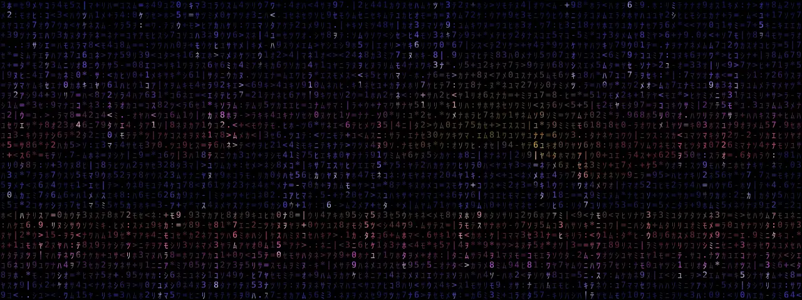
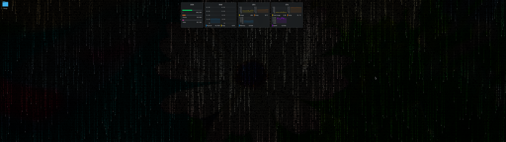
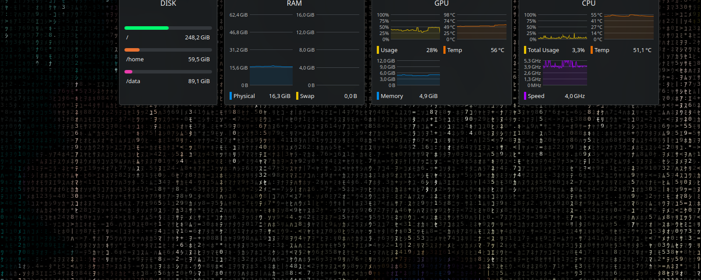

# MatrixWallpaper

A live wallpaper for KDE Plasma 6: Matrix-style falling glyphs, where every glyph takes the
colour your wallpaper picture has at that spot. The picture you had is still there, drawn in
rain.



*Three seconds of it, coloured from [this picture](docs/images/source.jpg), with `TrailFloor`
0.4 and `Lift` 0.75 so that a small picture reads. In a README it moves at 30 frames a second;
on your desktop it moves at your display's refresh rate.*

On a real desktop, 5120×1440 (click for full size):



The same screenshot at real size:



## What it does

- **Colours from your picture.** Each glyph cell takes the average colour of the picture under
  it. Dark pictures are lifted so the rain stays readable, without changing their hues.
- **The picture stays visible.** Trails do not fade to black unless you want them to: every
  glyph keeps a minimum brightness, so the whole picture shows as a mosaic of characters with
  the drops running through it.
- **As smooth as your screen.** It draws once per displayed frame, and the light slides down
  through the glyphs pixel by pixel instead of jumping a cell at a time. Measured at 240 frames
  a second on a 240 Hz display.
- **All on the GPU.** The whole effect is one fragment shader: one draw call, two texture
  lookups per pixel, no particle simulation on the CPU.
- **Fits the screen.** The glyph grid ends exactly at the screen's edges; no column is cut.
- **Out of the way of games.** It pauses while a fullscreen window has the focus.
- **Icons, widgets and panels untouched.** It is a Plasma wallpaper plugin, not a window drawn
  over your desktop.

**Status: early, and a project for fun.** It has run on one machine so far (Kubuntu 26.04,
Plasma 6.6, Wayland, NVIDIA).

## Install

You need KDE Plasma 6 and a working GPU driver. [`docs/deps.md`](docs/deps.md) has the full
list.

```sh
git clone https://github.com/TominoCZ/MatrixWallpaper.git
cd MatrixWallpaper
./run.sh install    # adds "Matrix Wallpaper" to Plasma's wallpaper types, for your user only
./run.sh apply      # switches every desktop to it, using the picture each one shows now
```

`apply` reads the picture from Plasma's own image wallpaper and leaves that setting alone, so
going back is one command:

```sh
./run.sh revert     # your old wallpaper, exactly as it was
```

To remove it completely, revert and then
`kpackagetool6 --type Plasma/Wallpaper --remove io.github.tominocz.matrixwallpaper`.

To update: `git pull`, `./run.sh install`, then restart plasmashell
(`systemctl --user restart plasma-plasmashell`), which is the only way Plasma loads a
wallpaper's new code.

## Use

Try it without touching the desktop: `./run.sh` opens the rain in a window, coloured from your
current wallpaper (this needs the development packages in [`docs/deps.md`](docs/deps.md)).

**Settings:** right-click the desktop, *Configure Desktop and Wallpaper…*. The page has a live
preview of the rain with your settings before you apply them, a file chooser for the picture,
and a line under each setting saying what it does.

The same settings can be changed from a terminal with `./run.sh set KEY VALUE`, which takes
effect at once:

| Key | What it does | Default |
|---|---|---|
| `Image` | The picture the rain takes its colours from: the full path of an image file. Empty gives classic green. | the picture `apply` found |
| `CellHeight` | Height of a glyph cell in pixels. Smaller cells give a finer picture; below about 14 the glyphs get thin and dim. | `16` |
| `Speed` | Pixels per second for the fastest drops; the slowest fall at a third of it. `0` stops the rain, and with it everything it costs. | `480` |
| `TrailFloor` | How dark a glyph may get, 0 to 1. `0` lets trails fade to black, as in the film; higher keeps more of the picture on screen. | `0.25` |
| `Lift` | Brightens dark pictures, 0 to 1. `0` leaves each glyph as dark as the picture is there; `1` gives every glyph full brightness in its own colour. | `0.5` |
| `Glide` | `1`: the light slides down through the glyphs. `0`: each glyph lights up as a whole, a cell at a time. | `1` |

```sh
./run.sh set Image "/home/you/Pictures/some picture.jpg"
./run.sh set TrailFloor 0.4
```

## What it costs

It draws a full-screen frame for every frame your display shows, inside plasmashell. On the
author's machine (RTX 3080 Ti, one 5120×1440 screen at 240 Hz) that is 240 frames a second and
about a quarter of one CPU core for plasmashell; a photo wallpaper costs about 1 %. A 60 Hz
screen draws a quarter as many frames.

`./run.sh perf` measures it on your machine: CPU, GPU, and the frame rate the wallpaper
really reaches.

It **pauses while a fullscreen window has the focus**, such as a game, borderless or not: then
it draws nothing and plasmashell is back to about 1 % of a core. It keeps running behind ordinary
and maximized windows. `./run.sh set Speed 0` stops it by hand.

## Known limits

- The picture has to be an image file. Plasma's bundled wallpapers are folders holding several
  sizes; pointed at one, the rain is green.
- It does not follow a slideshow, or a picture changed later in Plasma's own image wallpaper:
  set `Image` again, or run `./run.sh apply` again.
- Display scaling other than 100 % is untested.
- The rain makes one visible jump after about two years of uninterrupted running (its clock
  wraps).
- **NVIDIA: plasmashell's memory grows while the rain runs**, by about 200 MB an hour at 240 fps,
  because of a leak in NVIDIA's newer EGL Wayland library (`libnvidia-egl-wayland2`), which loses
  about 230 bytes for every frame any Qt OpenGL program presents. If you have the older
  `libnvidia-egl-wayland` installed too (Ubuntu ships both), you can point plasmashell alone at
  it; the path of the `.json` file may differ on other distributions:

  ```sh
  mkdir -p ~/.config/systemd/user/plasma-plasmashell.service.d
  printf '[Service]\nEnvironment=__EGL_EXTERNAL_PLATFORM_CONFIG_FILENAMES=%s\n' \
    /usr/share/egl/egl_external_platform.d/10_nvidia_wayland.json \
    > ~/.config/systemd/user/plasma-plasmashell.service.d/egl-wayland.conf
  systemctl --user daemon-reload && systemctl --user restart plasma-plasmashell
  ```

  To undo it, delete that file and run the last line again.
- It needs a GPU: Qt's software renderer cannot run the shader.

## How it works

The screen is a grid of glyph cells. For every pixel, one fragment shader works out which cell
it is in, how far that cell is behind a falling drop's head, which glyph the cell shows right
now, and what colour the picture has there; all of it from the cell's position and the time,
with nothing remembered between frames. The picture is decoded once, at about one texel per
cell, and the glyphs are drawn once into a texture.

[`docs/PLAN.md`](docs/PLAN.md) is the full design, with every decision and the options that
were rejected.

## Develop

```sh
./run.sh            # live preview in a window
./run.sh check      # render frames off-screen and assert on them
./run.sh shots      # render every state to .dev/shots/ and audit it
./run.sh build      # bake the shader after editing package/contents/shaders/rain.frag
./run.sh perf       # cost and real frame rate of the wallpaper running on the desktop
python3 scripts/readme.py   # the pictures in this file
```

The checks render real frames, so they need a GPU and a desktop session; one of them shows a
small window for about three seconds to measure the frame rate.
[`docs/deps.md`](docs/deps.md) lists what a machine needs to run and to develop it.

## Licence

[MIT](LICENSE). Do what you like with it.
